# Slussen: Governed Commerce Platform

Contract-enforced, event-driven ingestion from S3 into a Snowflake medallion platform, orchestrated with Airflow, serving a Power BI dashboard and natural-language analytics that return the same numbers.

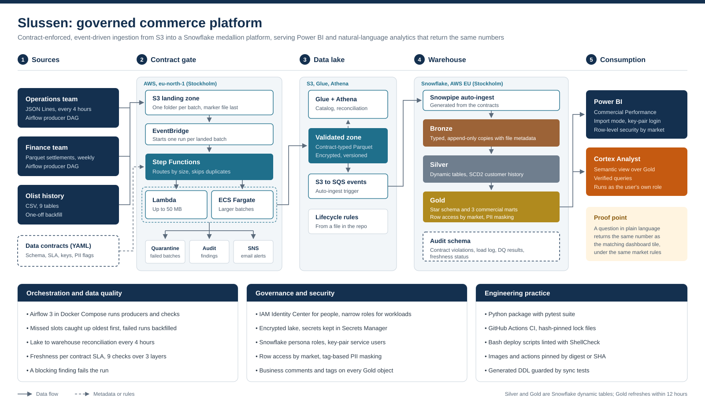

## The business question

An e-commerce company wants to know where its revenue growth comes from, and whether it relies on new or returning customers. Two source teams deliver data to S3 under data contracts: Operations every 4 hours and Finance weekly. Two years of history (the public Olist e-commerce dataset, shifted forward in time) entered through the same contract gate as a one-off backfill.

The platform answers four questions for executives, sales and growth:

- Is revenue growing?
- Which categories drive it?
- Are we keeping customers?
- How much do customers spend?

**Why "Slussen"?** Slussen is Stockholm's lock between Lake Mälaren and the Baltic Sea, controlling what flows through. The contract gate does the same between the S3 lake and Snowflake: only valid data passes.

## How data flows

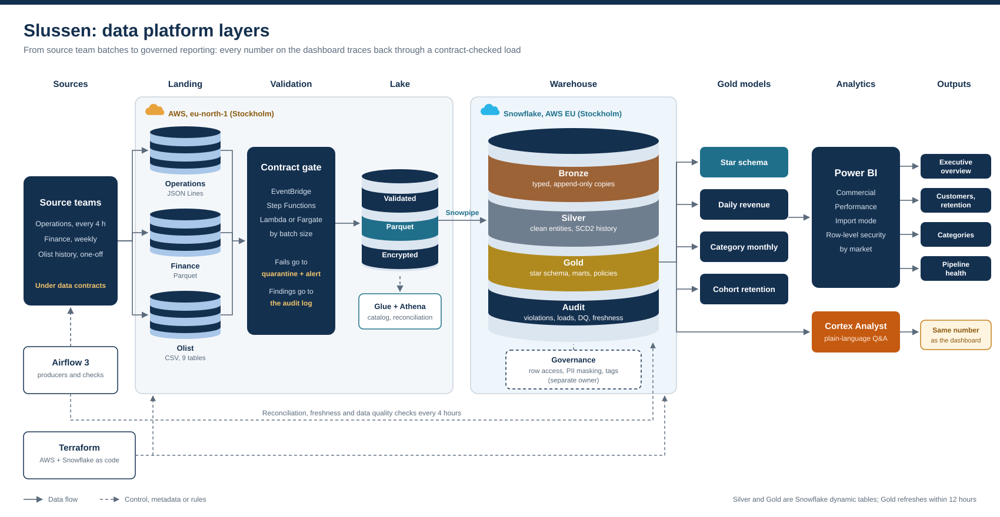

1. **Producers.** Airflow DAGs simulate the two source teams. Each batch lands in its own S3 folder, data files first and a `_SUCCESS` marker last.
2. **Contract gate.** The marker's "Object Created" event triggers an EventBridge rule, which starts one Step Functions execution per batch. The state machine routes batches up to 50 MB to Lambda and larger ones to ECS Fargate (with a task token). Both run the same validator image.
3. **Outcomes.** Valid batches are written as contract-typed Parquet to the validated zone. Broken batches are copied unchanged to quarantine, findings go to the audit log, and every failure sends an email alert. Re-uploads of a batch that was already decided are parked, not loaded twice.
4. **Load.** S3 events on the validated zone trigger Snowpipe, which loads typed Bronze tables generated from the contracts.
5. **Transform.** Silver dynamic tables clean and merge history with the latest live snapshot per order. A stream plus a serverless task keeps an SCD2 customer address history. Gold dynamic tables hold a star schema and three commercial marts.
6. **Serve.** Power BI imports Gold for the Commercial Performance dashboard. Cortex Analyst answers plain-language questions over a semantic view of the same Gold tables, with metrics defined exactly as the dashboard calculates them.
7. **Check.** Fifteen minutes after each operations batch, Airflow reconciles the lake against Bronze, checks freshness against each contract's SLA and runs 9 data quality checks over Bronze, Silver and Gold. A blocking finding fails the run.

## Tech stack

| Area | Tools |
| --- | --- |
| Cloud | AWS eu-north-1 (Stockholm), Snowflake Enterprise on AWS EU (Stockholm) |
| Ingestion | S3, EventBridge, Step Functions, Lambda (container image), ECS Fargate, ECR, SNS, SQS, Snowpipe |
| Lake | Parquet, Glue Data Catalog with partition projection, Athena |
| Warehouse | Snowflake dynamic tables, streams, serverless tasks, row access and masking policies, tags |
| Orchestration | Apache Airflow 3 in Docker Compose (LocalExecutor) |
| Analytics | Power BI Desktop, Snowflake semantic view, Cortex Analyst |
| Engineering | Python 3.13 package with pytest, hashed lock files, GitHub Actions CI, Bash deploy scripts with ShellCheck |
| Infrastructure as code | Terraform 1.11.4 (snowflakedb/snowflake, hashicorp/aws), S3 backend with native locking |
| Security | IAM Identity Center, least-privilege IAM roles, KMS, Secrets Manager, Snowflake key-pair service users |

## What is in the platform

### Data contracts

Every feed has a version-controlled YAML contract: name, semantic version, owner, format, location, completion marker, SLA, primary key, and columns with type, nullability, PII flag and description. Contracts check shape. Value rules and cross-batch rules live in data quality checks. Bronze DDL, Snowpipes and Athena tables are generated from the contracts and guarded by sync tests. See [contracts/README.md](contracts/README.md).

| Contract | Owner | Format | Cadence |
| --- | --- | --- | --- |
| `ops_orders` | Operations | JSON Lines (nested items and payments) | Every 4 hours, data no older than 5 hours |
| `finance_settlements` | Finance | Parquet | Weekly, by Monday 06:00 UTC |
| `olist_<table>` (9 tables) | Data platform | CSV | One-off backfill |

### Snowflake layers

| Schema | Holds | Built with |
| --- | --- | --- |
| `BRONZE` | Typed, append-only copies of validated files plus file metadata | 11 generated auto-ingest Snowpipes |
| `SILVER` | One clean table per entity, reference data, SCD2 customer history | Dynamic tables; stream + serverless triggered task + `MERGE` |
| `GOLD` | Star schema (`FCT_ORDERS`, `FCT_ORDER_ITEMS`, `DIM_CUSTOMER`, `DIM_PRODUCT`, `DIM_DATE`, `DIM_MARKET`) and marts (daily revenue, category monthly, cohort retention) | Dynamic tables with a 12-hour target lag, and views |
| `AUDIT` | Contract violations, producer load log, DQ results, freshness | Audit Snowpipe; Airflow writes the rest |
| `GOVERNANCE` | Market access mapping, row access policy, tags, masking policy | Owned by a separate admin role |

Definitions, grains and lineage: [docs/data_model.md](docs/data_model.md).

### Governance and security

- **Row access by market.** Markets are Brazil's five regions. A row access policy on every Gold fact, mart and the market dimension reads a mapping table, so an analyst for one region sees only that region.
- **Tag-based PII masking.** Customer location columns carry a `PII` tag bound to a masking policy. Real values appear only with a dedicated PII reader role in the session.
- **Business metadata.** Every Gold object and column has a business-language comment; every Gold object carries a `DOMAIN` tag. This is what the semantic layer builds on.
- **Power BI row-level security** mirrors the Snowflake mapping table by table, verified with "View as" against Gold filtered by market. Cortex Analyst runs as the user's own role, so the Snowflake policy applies directly.
- **Identity.** People sign in through IAM Identity Center and Snowflake persona roles. Workloads use narrow IAM roles and Snowflake service users with key pairs. Private keys live in Secrets Manager or an encrypted key file, never in the repo.
- **No identifiers in the repo.** Account IDs, ARNs and the Snowflake account locator are looked up at runtime. A check script scans staged files before every commit, and CI runs the same check.

### Data quality

| Check | Layer | Severity |
| --- | --- | --- |
| Lake vs Bronze reconciliation (Athena vs Snowflake, value level) | Lake, Bronze | Error |
| Freshness per contract SLA | Bronze | Error |
| Duplicate operations event ids | Bronze | Error |
| Customer history complete vs Bronze | Silver | Error |
| GMV ties across Gold facts and marts | Gold | Error |
| Gold freshness lag over 16 hours | Gold | Warn |
| Unknown products, status regressions, paid orders without payment, orders without payment | Bronze, Silver | Warn |

Results land in `AUDIT.DQ_RESULTS` as counts only, never record values.

### Commercial Performance dashboard

| Page | Contents |
| --- | --- |
| Executive overview | GMV, orders, average and median order value, YTD GMV, 7- and 28-day moving averages, growth vs last week and month |
| Customers and retention | Repeat-customer rate, spend quartiles, cohort heatmap, month-1 retention |
| Categories | Top categories and their share of GMV |
| Pipeline health | Latest load, freshness and DQ status from the audit schema |

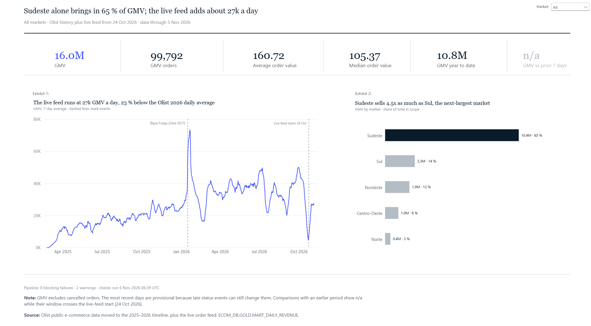

*Executive overview: headline GMV and order-value tiles, the 7-day GMV trend with event markers, and GMV share by market.*

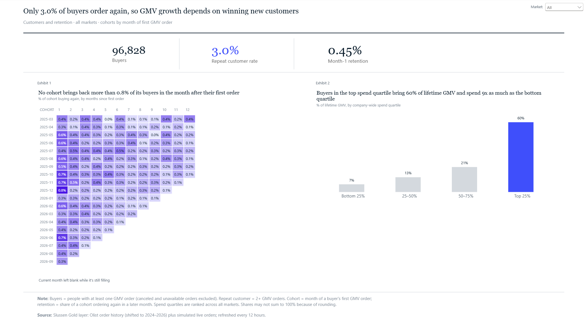

*Customers and retention: buyers, repeat-customer rate and month-1 retention, the monthly cohort heatmap, and lifetime GMV by spend quartile.*

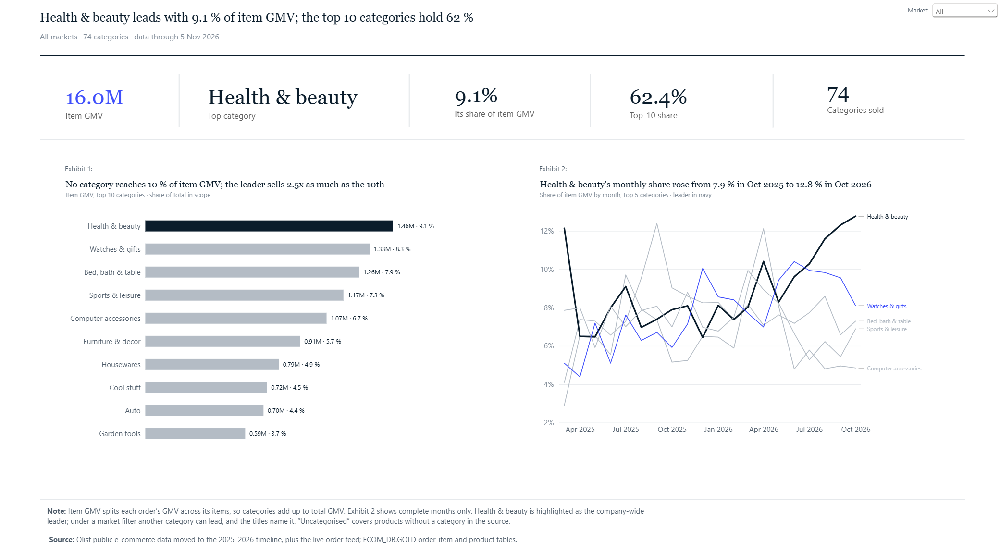

*Categories: the top 10 categories by item GMV and the monthly share trend of the top 5.*

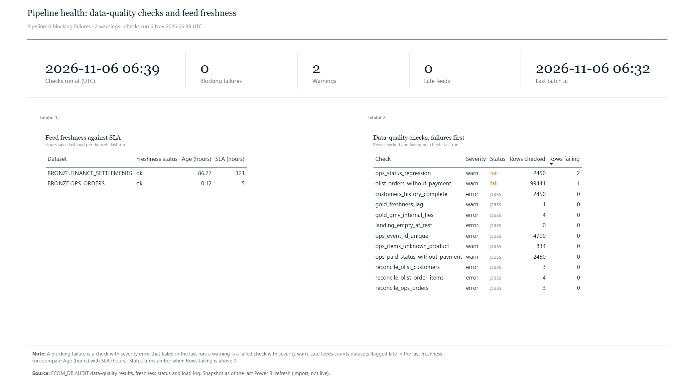

*Data-quality checks from the 2026-11-06 run. All error-level checks pass; two warn-level checks flag known edge cases (one Olist order without a payment and two status regressions in the operations feed) without blocking the run.*

The proof point: a question to Cortex Analyst in plain language returns the same number as the matching dashboard tile, under the same market rules.

Key figures (Olist history plus the live feed, all markets):

| Metric | Value |
| --- | --- |
| GMV (item price + freight, excluding canceled and unavailable orders) | 16.0M |
| GMV orders | 99,792 |
| Average order value | 160.72 |
| Median order value | 105.37 |
| Repeat-customer rate (people with 2+ GMV orders over buyers) | 3.0 % |
| Month-1 retention | 0.45 % |

Figures as of the 2026-11-06 refresh; operations batches keep arriving, so live numbers move.

### Same question, same number: Cortex Analyst vs Power BI

Both sides run as ANALYST_NORTE under the same Snowflake row access policy; Power BI uses "View as" Norte.

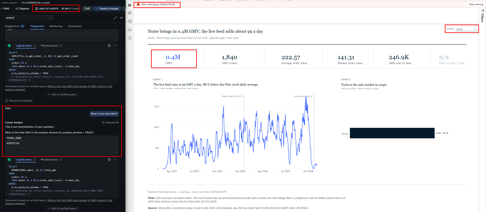

*Q1, total GMV: Cortex Analyst returns 409,522.85; the Power BI tile shows 0.4M.*

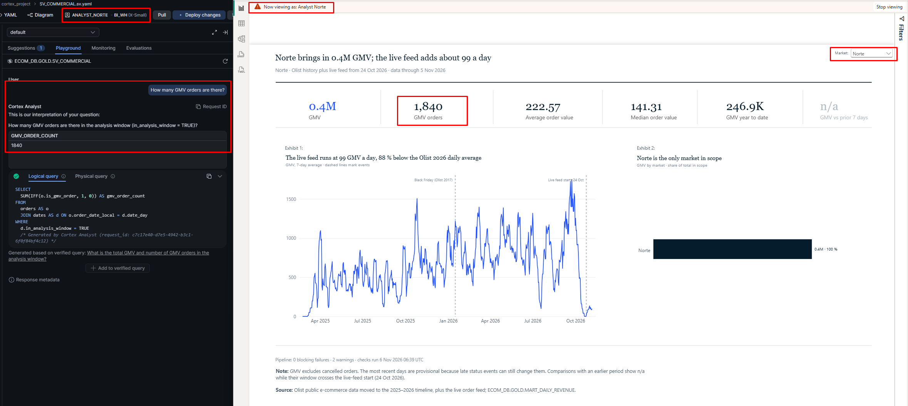

*Q2, GMV orders: 1,840 on both sides.*

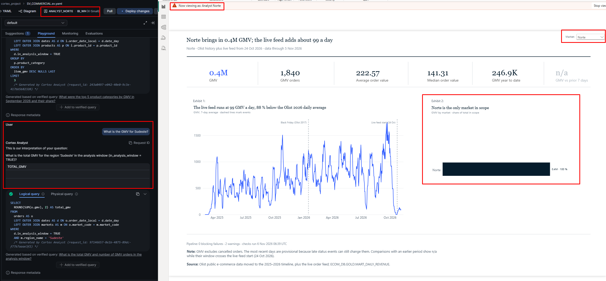

*A Norte analyst asking about Sudeste gets nothing back: AI respects row-level security.*

| Question | Cortex Analyst | Power BI | Match |
| --- | --- | --- | --- |
| Q1 Total GMV | 409,522.85 | 0.4M (tile rounds) | Yes |
| Q2 GMV orders | 1,840 | 1,840 | Yes |
| Q3 Average order value | 222.57 | 222.57 | Yes |
| Q4 Top 3 categories by GMV | Health & beauty 49,798.07; Watches & gifts 42,237.06; Sports & leisure 32,873.78 | Health & beauty 50K; Watches & gifts 42K; Sports & leisure 33K | Yes |
| Q5 GMV for Sudeste (as ANALYST_NORTE) | Empty result | Norte is the only market in scope | Yes |

The demo caught two real defects: two verified queries had drifted after a schema change and Cortex was silently skipping them, and Cortex counted 1,846 GMV orders against the dashboard's 1,840 until the analysis-window rule was aligned with the dashboard. Both were fixed in [#61](https://github.com/Kronus4k/slussen/pull/61).

Screenshots for Q3 and Q4: [average order value](docs/images/cortex/03_aov_cortex_vs_powerbi.png), [top 3 categories](docs/images/cortex/04_categories_cortex_vs_powerbi.png).

## Engineering practice

- **Idempotent by design.** Derived objects use `CREATE OR REPLACE`; stateful objects use `IF NOT EXISTS`; seed data uses `MERGE`; producers skip batches that were already decided; missed Airflow slots are caught up oldest first.
- **Tested.** 152 pytest tests, including layout and type tests that run through the real gate entry point.
- **Supply chain.** GitHub Actions pinned by commit SHA, Python dependencies installed with `--require-hashes`, base images pinned by digest.
- **Measured, not assumed.** Warehouse generations were benchmarked before choosing one; see [docs/query_optimization.md](docs/query_optimization.md).
- **Small pull requests.** One branch per component, squash merge, conventional commit messages, CI green before merge.
- **Infrastructure as code.** 105 existing objects across Snowflake and AWS (warehouses, ECOM_DB and its schemas, the resource monitor, the storage integration, its IAM role and policy, the S3 buckets, and the 25 account roles with their role hierarchy and grants) were imported into Terraform with zero drift. The plan is empty on main. Governance policies stay with PLATFORM_ADMIN on purpose (separation of duties). See [infra/terraform/README.md](infra/terraform/README.md).

## Cost

The whole platform has run on about 4 Snowflake credits over its first two weeks, including the full backfill. Guardrails: X-Small warehouses with 60-second auto-suspend, a warehouse resource monitor, an account budget that also covers serverless work, an AI quota, and Cortex limited to one role. Airflow runs locally in Docker; MWAA is documented as the production target only, because it bills by the hour even when idle.

Latest baseline, 12 Oct to 5 Nov 2026: about 6.1 credits billed (warehouses 5.81, serverless tasks 0.25, AI functions 0.00), taken before any Cortex work.

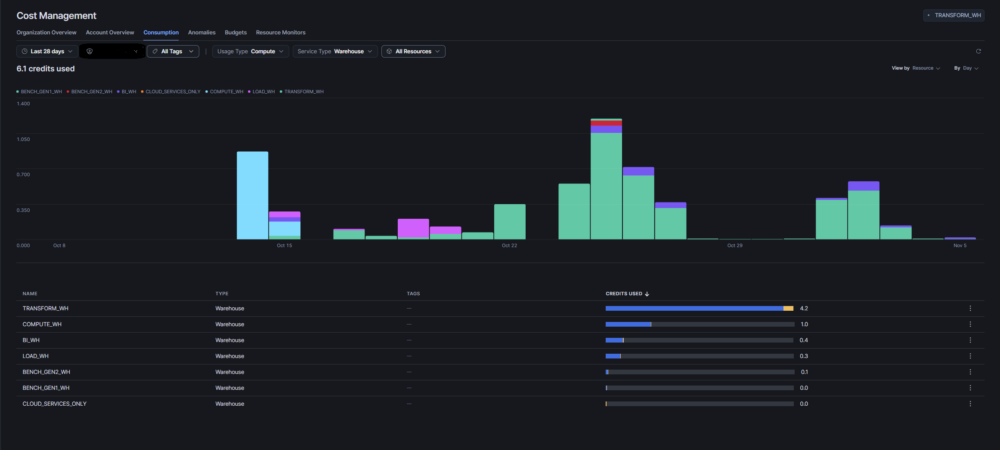

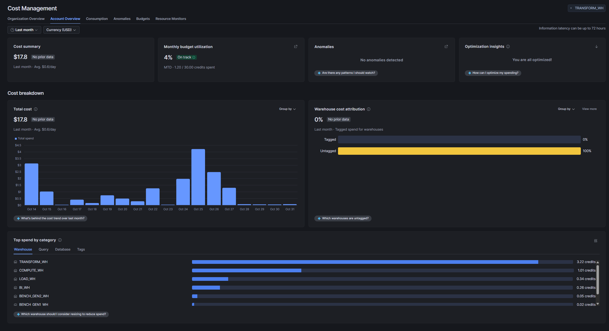

Raw numbers: [docs/cost/2026-11-05_baseline.csv](docs/cost/2026-11-05_baseline.csv)

## Repository layout

```
contracts/          YAML data contracts, one per feed
src/pipeline_core/  validator, readers and writers, producers, generators, checks, DDL generators
tests/              pytest suite
airflow/dags/       producer DAGs, platform_checks, DQ SQL
docker/             Airflow and validator images
infra/              IAM policies, state machine, task definitions, S3 configs (templates)
infra/terraform/    Terraform for Snowflake and AWS (imported, plan-clean)
scripts/            bootstrap, deploy (cmd and Bash), checks
sql/                setup, bronze, silver, gold, governance, checks, benchmarks
docs/               data model, orchestration runbook, decisions, query optimization
```

## Running it

Prerequisites: an AWS account with IAM Identity Center, a Snowflake Enterprise account in the same region, Docker, and Python 3.13.

1. Create the AWS foundation and the contract gate with the scripts in `scripts/bootstrap/`, in numeric order. Settings come from `.env` (see `.env.example`).
2. Run the Snowflake SQL in `sql/setup/`, then `sql/bronze/`, `sql/silver/`, `sql/gold/` and `sql/governance/` in numeric order.
3. Start Airflow with `docker compose -f airflow/docker-compose.yaml up -d` (see `airflow/.env.example`), then unpause the DAGs in the order given in [docs/orchestration.md](docs/orchestration.md).
4. Install the Python package for tests: `pip install --require-hashes -r requirements-dev.lock`, then `pip install --no-deps -e .` and `pytest`.

The runbook in [docs/orchestration.md](docs/orchestration.md) covers backfills, pausing and recovery.

## Design decisions

Every significant choice is recorded with its reason and the rejected alternative in [docs/decisions.md](docs/decisions.md). A few that shape the platform:

- Validation runs on AWS before Snowflake, so files that break a contract never reach Bronze.
- Lambda for small batches, Fargate for large ones: the 50 MB threshold comes from a measured capacity test.
- Snowflake-native transforms (dynamic tables, streams, tasks) for the first version; dbt Core is the planned next step.
- Power BI imports Gold instead of querying it live, which keeps the warehouse asleep between refreshes.
- Markets come from real customer states, so row access works on real data without currency conversion.

## Roadmap

- **Next:** terraform plan on every pull request; future grants in Terraform; separate dev and prod environments
- **Next:** Cortex smoke test on the merged semantic view (#49), measured against the cost baseline; review enrichment with Cortex AI functions; Cortex Search over contracts and runbooks
- Migrate Silver and Gold to dbt Core, run through Airflow with Astronomer Cosmos
- Delivery and Seller Operations dashboard; Finance Settlement Reconciliation dashboard
