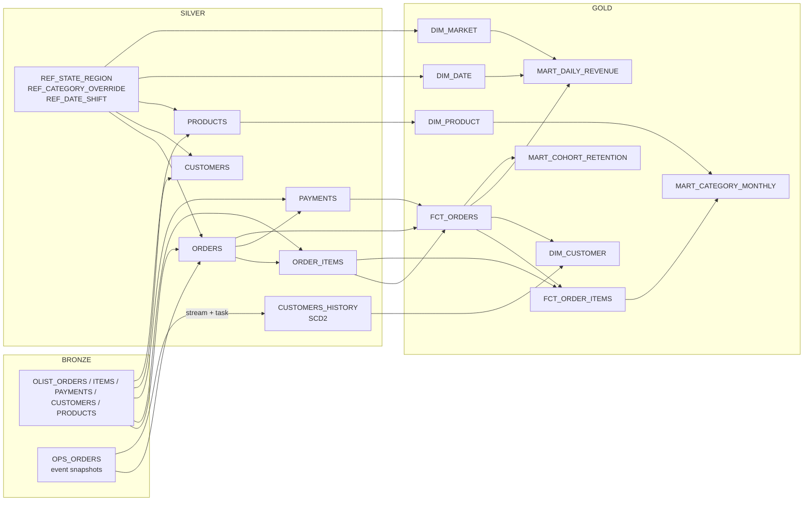
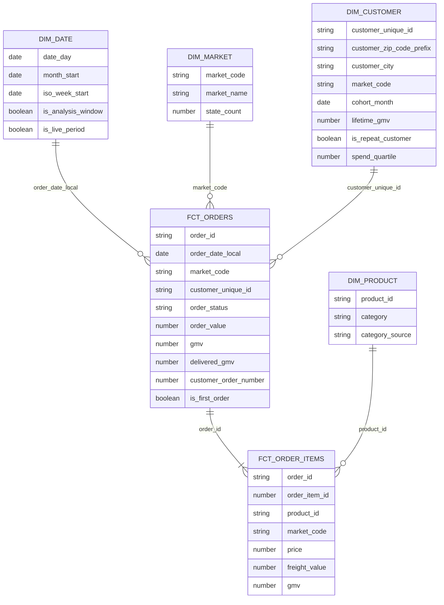

# Data model

Bronze holds typed copies of every file that passed the contract gate. Silver turns them into one clean table per entity. Gold is a star schema with marts for the Commercial Performance dashboard and the natural-language layer. Power BI and Cortex Analyst read Gold only.

## Lineage

## Gold star schema

## Grain of each Gold object

| Object | One row per | Built as |
| --- | --- | --- |
| `fct_orders` | order on the KPI timeline | dynamic table |
| `fct_order_items` | item of such an order | dynamic table |
| `dim_customer` | person (`customer_unique_id`) | dynamic table |
| `dim_product` | product, plus one `unknown` member | dynamic table |
| `dim_date` | calendar day | view |
| `dim_market` | market (one of Brazil's five regions) | view |
| `mart_daily_revenue` | day and market, including days without orders | dynamic table |
| `mart_category_monthly` | month, market and category | dynamic table |
| `mart_cohort_retention` | cohort month, market and months since the first purchase | dynamic table |

## Definitions

| Term | Definition |
| --- | --- |
| GMV | Item price + freight of orders that are not `canceled` or `unavailable`. The `gmv` column already applies this, so `SUM(gmv)` is correct everywhere |
| Delivered GMV | Item price + freight of `delivered` orders only |
| Market | One of Brazil's five regions, from the customer's state. Facts use the state at order time; `dim_customer` uses the person's current state |
| Repeat customer | A person with two or more GMV orders |
| Cohort | The month of a person's first GMV order, in the market of that order. Retention = active people / cohort size, aggregated as `SUM(active) / SUM(size)` |
| KPI timeline | Olist history up to the day before the anchor (2026-10-23), then the live ops feed from the anchor (2026-10-24) |
| Reporting day | `order_date_local`, the purchase date in Sao Paulo |

## Time handling

Olist times have no zone and are Sao Paulo wall time. Silver shifts them by whole days (2,975 days, 425 weeks, so weekdays stay the same), then converts them to UTC. The live ops feed is already UTC. The rule lives in one row of `SILVER.REF_DATE_SHIFT`.

## Sums that don't add up across markets

Moving averages and YTD totals in `mart_daily_revenue` add up across markets. Ranks and shares in `mart_category_monthly` are per market, and retention rates are ratios: company-wide values are computed from `gmv`, `active_customers` and `cohort_size`, not by adding or averaging the per-market values.

## Refresh

Silver dynamic tables refresh when a Gold table needs them (`DOWNSTREAM`). Gold refreshes every 12 hours. Each refresh reads all sources as of one data timestamp, so Silver and Gold always agree with each other. `CUSTOMERS_HISTORY` is a table, kept current by a stream on Bronze ops events and a serverless task.

## Governance

- **Row access:** `GOVERNANCE.RAP_MARKET` on every Gold object with `market_code`, driven by `GOVERNANCE.MARKET_ACCESS`. Regional analysts see their market, executives and the reporting role see all, an unmapped role sees nothing.
- **Masking:** columns tagged `GOVERNANCE.PII = 'location'` (zip prefix and city in `dim_customer`) are masked unless `PII_READER` is active.
- **Catalog:** every Gold object is tagged `GOVERNANCE.DOMAIN = 'commercial'`.
